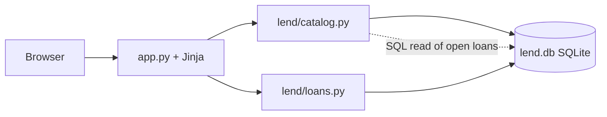
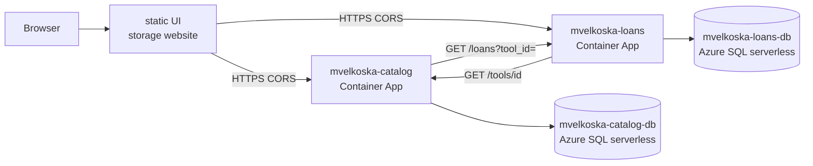
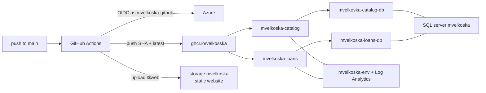
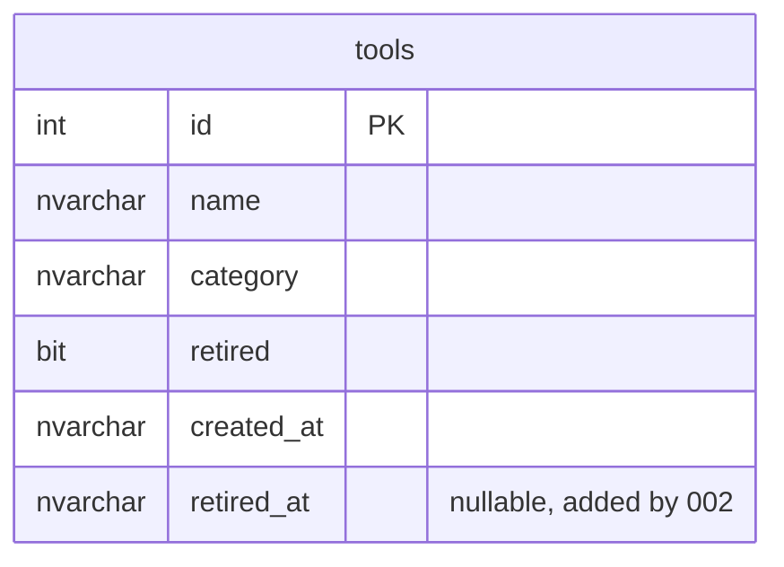
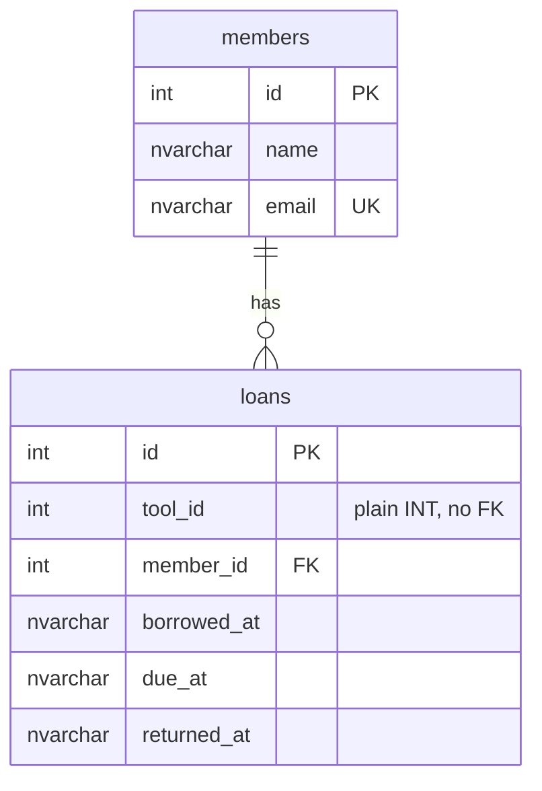

# Assignment 2 report: Lend

**Live URL:** [https://mvelkoska.z28.web.core.windows.net](https://mvelkoska.z28.web.core.windows.net)
**Repository:** [https://github.com/velkosska/assignment-2-devops](https://github.com/velkosska/assignment-2-devops)

Lend is a one-desk tool library. Assignment 1 was one Flask process and one SQLite file. Assignment 2 splits it into two services with their own databases, deploys them to Azure Container Apps, and serves the UI from a storage static website. This report matches the deployment at the graded commit.

## 1. Architecture, before and after

### Before (Assignment 1)

One process rendered Jinja pages and wrote every table through `sqlite3`. Catalog and loans shared the file. `retire_tool` read open loans with SQL, and `borrow_tool` read `tools.retired` the same way. The seam of ADR-2 lived only in the modules.

### After (Assignment 2)

Catalog owns `tools` in database `catalog`. Loans owns `members` and `loans` in database `loans`. The foreign key from `loans.tool_id` to `tools.id` is gone. Borrow and repeat call `GET {CATALOG_URL}/tools/{id}`. Retire calls `GET {LOANS_URL}/loans?tool_id={id}`. Each call has a timeout (2 s locally, 10 s on Azure) and fails closed with `503` and no write if the other service does not answer. Tool names on the loans pages are joined in the browser. ADR-2 held: the seam did not move (ADR-6).

## 2. Deployment

The pipeline on a push to `main` builds SHA-tagged images, pushes them to GHCR, updates both Container Apps, uploads the UI with a generated `config.js`, and verifies `/health` and the version. The first-time resources are created once by `infra/setup.sh`. The professor has Reader on `rg-mvelkoska`. Names use the prefix `mvelkoska` (storage account and SQL server keep that short form, which the professor accepted).

| Resource | Name | Cost model |
|---|---|---|
| Resource group | `rg-mvelkoska` | free |
| Managed identity | `mvelkoska-github` | free |
| Container Apps environment | `mvelkoska-env` | pay per use, logs free to 5 GB/month |
| Container apps (0–1 replica) | `mvelkoska-catalog`, `mvelkoska-loans` | nothing while idle |
| SQL server + 2 serverless DBs (free offer) | `mvelkoska`, `mvelkoska-*-db` | free offer, pause after 60 min |
| Storage static website | `mvelkoska` | pay per use |
| Image registry | `ghcr.io/velkosska` | free |

### Pipeline evidence

| Run | Link | What it shows |
|---|---|---|
| Successful CD with migration 002 | [run 44928998253](https://github.com/velkosska/assignment-2-devops/actions/runs/44928998253) | images, deploy services, deploy UI, verify on commit `09dabcc…` |
| Failed then fixed | [run 44539433607](https://github.com/velkosska/assignment-2-devops/actions/runs/44539433607) | first attempt failed at `azure/login` with `AADSTS700213` (OIDC subject was name-only; GitHub sends owner and repo numeric ids). The federated credential was updated and the rerun passed. `infra/setup.sh` now builds the subject from those ids. |

## 3. Databases and migrations

### Catalog

### Loans

The partial unique index `one_open_loan_per_tool` still enforces one open loan per tool inside the loans database. Integrity of `tool_id` is checked over HTTP at write time (ADR-7).

### Migration evidence on Azure

Migration `002_add_retired_at.sql` adds a nullable `tools.retired_at` and backfills already-retired tools with their `created_at`. It ran on a database that already held four tools. Full capture: [`docs/evidence/migration-002.md`](docs/evidence/migration-002.md).

| Evidence | Value |
|---|---|
| Before | [`migration-002-before.json`](docs/evidence/migration-002-before.json) — 4 tools, Samsung Galaxy J5 retired, no `retired_at` field |
| Deployment | [run 44928998253](https://github.com/velkosska/assignment-2-devops/actions/runs/44928998253), commit `09dabcca…` |
| Startup log | `2026-11-21T17:17:36Z INFO applied migration 002_add_retired_at.sql` |
| After | [`migration-002-after.json`](docs/evidence/migration-002-after.json) — same 4 ids and values; retired tool has `retired_at = created_at`; others `null` |

Only 002 ran: 001 was already recorded. The backfill is an approximation, because the real retirement time was never stored (ADR-7).

## 4. Partial failure

With one service stopped, the other keeps serving its own domain, and the cross-seam call fails closed. Captured on the compose stack on 2026-11-22 ([`docs/evidence/partial-failure.md`](docs/evidence/partial-failure.md)):

| Case | Response | Own domain | Write |
|---|---|---|---|
| Catalog stopped, `POST /loans` | `503` `"Catalog service unavailable…"` | loans `/health` still `200` | open loans stayed `[]` |
| Loans stopped, `POST /tools/{id}/retire` | `503` `"Loans service unavailable…"` | catalog `/health` still `200` | tool stayed `"retired": false` |

The same cases are asserted by `tests/integration/test_seam.py`. On Azure, a cold start can look the same for about a minute; the UI shows "starting up, try again" and retries reads (ADR-8).

## 5. Decisions in short

| ADR | Decision |
|---|---|
| 6 | Seam stays where ADR-2 put it. Cross-seam calls are server-side, fail closed. |
| 7 | Own numbered SQL runner, additive migrations, recovery by new migration or earlier image SHA. |
| 8 | Consumption Container Apps, free-offer serverless SQL, storage static website, GHCR, OIDC. Scale to zero accepted; measured cold starts 5–13 s. |
| 9 | CI gates on lint, coverage ≥70%, OpenAPI, system.yaml, compose integration. Stubs for unit tests, real stack for the seam. |
| 10 | No cache for the tool lookup: a stale entry could lend a retired tool, and a cache server is out of scope. |

## AI disclosure

I acknowledge the use of Cursor to draft the split, the containers, the pipeline, the Azure setup, the migrations, the ADRs and this report. Every change is logged in [`AI_USAGE_ASSIGNMENT2.md`](AI_USAGE_ASSIGNMENT2.md). I checked the output against the tests, the compose stack and the live Azure deployment before keeping it.
