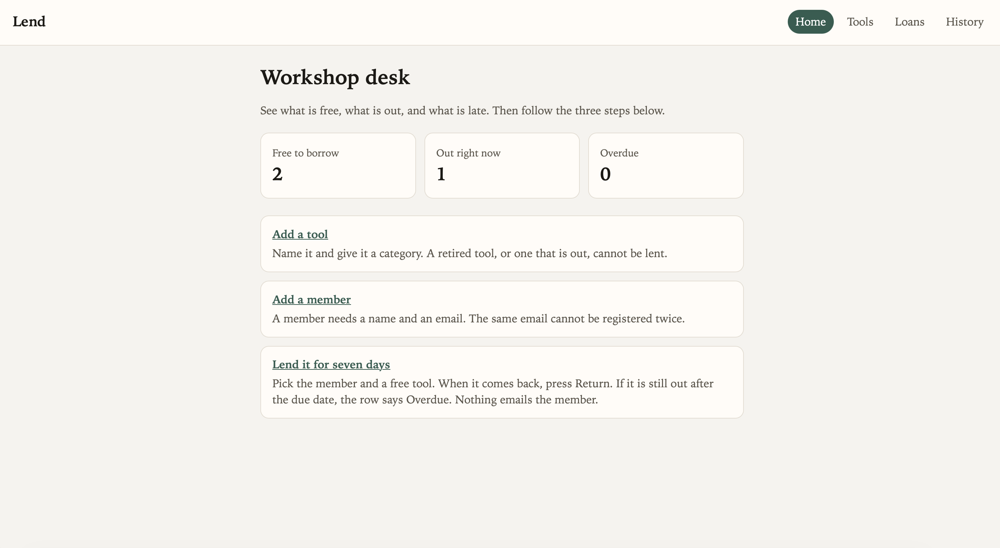
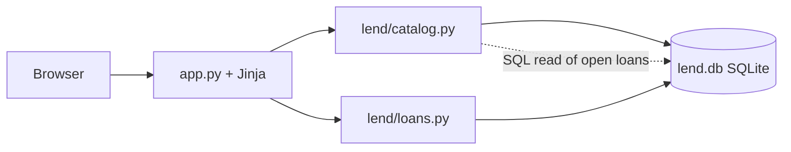
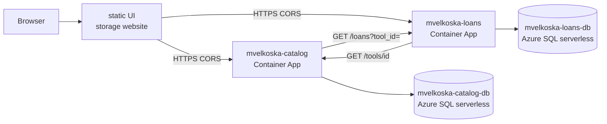
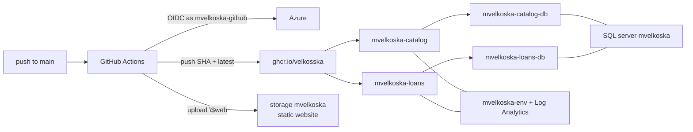
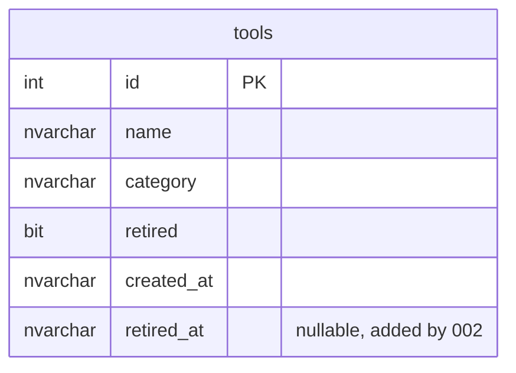
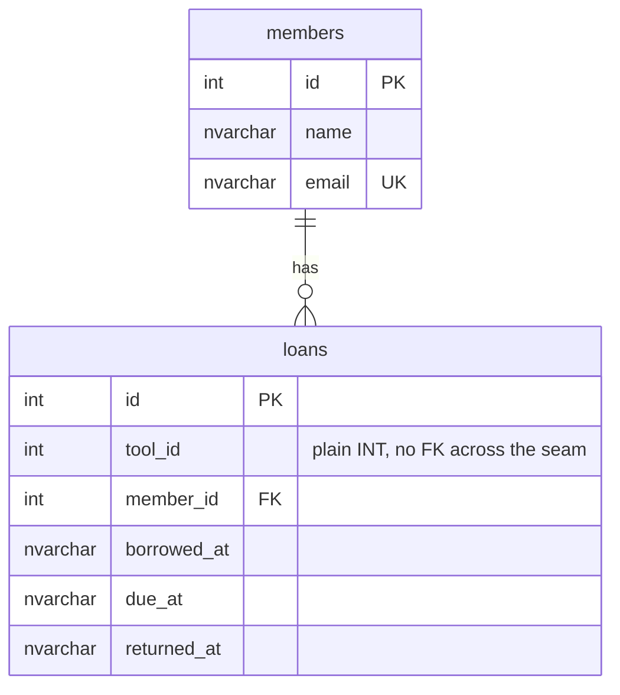

# Assignment 2 report: Lend

**Live URL:** [https://mvelkoska.z28.web.core.windows.net](https://mvelkoska.z28.web.core.windows.net)  
**Repository:** [https://github.com/velkosska/assignment-2-devops](https://github.com/velkosska/assignment-2-devops)

Lend is a one-desk tool library for a volunteer workshop. Assignment 1 was one Flask process and one SQLite file. Assignment 2 splits it into two services with their own databases, deploys them to Azure Container Apps, and serves the UI from a storage static website. This report matches the deployment at the graded commit. It covers how the work was planned, what the architecture became, how it is operated on Azure, and the evidence required by the brief.

Both domains work end to end on Azure through that URL: tools, members, loans, overdue and history. CORS on each service allows only this origin (`https://mvelkoska.z28.web.core.windows.net`). Screenshot of the live home page (free / out / overdue after real data):

## 1. Planning and process

### Stakeholders

Two people use the system. The **volunteer at the desk** is the only operator: they add and retire tools, register members, lend and return tools, and look at overdue and history. The **member who borrows** never signs in; they only appear as a name and email on the loans page. There is no reminder email (ADR-5 from Assignment 1 still holds). The system must stay cheap while idle, because a workshop desk is quiet for most of the week, and it must stay understandable for a written comprehension check: every file in the repository may be asked about.

### Approach

Delivery was **iterative and incremental**, not a waterfall design-then-build. The brief fixed hard constraints early (two services, own databases, compose, GitHub Actions, serverless Azure, no secrets in the repo). Inside those constraints the order of work was chosen so each step left a running system: first a local split that a volunteer could still use, then tests and images, then Azure setup, then continuous deployment, then a data-preserving migration with evidence. Goals were set at the start of each block of work, with a target date and a checkable result. Some dates slipped by a day when Azure setup took longer than expected (Entra-only auth, firewall rules, OIDC subject format); the goals themselves did not change.

### Goals set while building

| Goal | Target | How it was checked |
|---|---|---|
| Two services, each with its own database and login, up with one command | By 10–11 Nov 2026 | `docker compose up --build` serves the UI on `:8080` and both `/health` endpoints answer `200` |
| Cross-seam flows over HTTP with timeouts; partial failure fails closed | By 11 Nov 2026 | Borrow and retire call the other service; `docker compose stop` of one side yields `503` and no write; integration test later locks this in |
| CI on every push: lint, tests, coverage ≥70%, OpenAPI, image build | By 18 Nov 2026 | Green Actions runs on pull requests; coverage fails the job below 70% |
| Cross-seam integration test on the real compose stack | By 18 Nov 2026 | `tests/integration/test_seam.py` lends across the seam and stops each service |
| One-time Azure setup in the student subscription; CD from `main` only | By 19–20 Nov 2026 | `infra/setup.sh` creates identity, DBs, apps; push to `main` deploys SHA-tagged images |
| UI on the storage static website; post-deploy verify of `/health` and version | By 20 Nov 2026 | Live URL loads; verify job compares `version` to `github.sha` |
| Migration that changes a table holding data, evidenced on Azure | By 21 Nov 2026 | Before/after JSON, startup log line, CD run link in `docs/evidence/` |
| ADRs 6–10 spanning at least three dates; report and submission tag | By 22 Nov 2026 | ADR dates 10, 18 and 21 Nov; this report; tag `submission` on the graded commit |

What was deliberately not built is recorded in ADR-10 (a cache for the tool lookup). No real workshop volunteer tried the live desk beyond my own use as the operator; that limit is the same honest gap as in Assignment 1.

## 2. Architecture, before and after

### Before (Assignment 1)

One process rendered Jinja pages and wrote every table through `sqlite3`. Catalog and loans shared the file. The seam of ADR-2 lived only in the modules: `lend/catalog.py` owned writes to `tools`, and `lend/loans.py` owned `members` and `loans`, but each domain still **read the other’s table with SQL**. `retire_tool` queried open loans; `borrow_tool` and the loan lists read or joined `tools`. The Assignment 1 feedback called that out: neither domain could be lifted without rewriting the other. The architecture diagram for Assignment 1 showed those cross-domain reads as dashed lines; it did not yet show a cut that would survive separate processes.

### After (Assignment 2): ownership and the seam

**Ownership.** Catalog is the only writer of `tools`, in database `catalog` (Azure: `mvelkoska-catalog-db`). Loans is the only writer of `members` and `loans`, in database `loans` (Azure: `mvelkoska-loans-db`). Each service connects with its own SQL login (`catalog_user`, `loans_user`), which has access only to its own database and only the roles `db_ddladmin`, `db_datareader` and `db_datawriter`. No service opens the other’s database.

**What crosses the seam.** The foreign key from `loans.tool_id` to `tools.id` is gone; `tool_id` is a plain `INT`. Integrity is enforced in code at write time, over HTTP:

- Borrow and repeat (loans → catalog): `GET {CATALOG_URL}/tools/{id}` checks that the tool exists and is not retired.
- Retire (catalog → loans): `GET {LOANS_URL}/loans?tool_id={id}` refuses retiring a tool that is out.

Each call has a timeout (2 seconds locally, 10 seconds on Azure so a cold start can finish). If the other service does not answer in time, the request returns `503` with a clear message and **writes nothing** (fail closed). Tool names on the loans and history pages are joined in the browser from `GET /tools`; if catalog is down those rows show `Tool #id` with a notice. That is the only client-side compensation; the rules that protect data stay server-side.

**ADR-2 held.** The seam did not move (ADR-6). The dashed SQL reads from Assignment 1 are exactly the two HTTP calls above. Two calls in total is evidence the seam is in the right place; many more would have suggested a bad cut.

## 3. Deployment and operations

### How a change reaches Azure

On a push to `main`, after CI passed for that same commit, GitHub Actions builds both images, tags them with the commit SHA (and `latest`), pushes them to GHCR, updates both Container Apps, uploads the UI with a generated `config.js`, and verifies that what is running is that commit. Pull requests only build and test; they never touch Azure. The first-time resources are created once by `infra/setup.sh`. After that, nothing is created or changed by hand in the portal. The professor has Reader on `rg-mvelkoska`.

**Naming.** Every resource uses the prefix `mvelkoska` (from my IE username). The brief’s examples use forms such as `<prefix>ui` for storage and `<prefix>-sql` for the server. My storage account and SQL server are both named `mvelkoska`, created from the course guide before the setup script and kept because the professor confirmed that an identifiable `mvelkoska` is enough. Container apps and databases follow `<prefix>-<service>` / `<prefix>-<service>-db`. `system.yaml` matches the deployed names.

| Resource | Name | Cost model |
|---|---|---|
| Resource group | `rg-mvelkoska` | free |
| Managed identity | `mvelkoska-github` | free |
| Container Apps environment | `mvelkoska-env` | pay per use, logs free to 5 GB/month |
| Container apps (0–1 replica) | `mvelkoska-catalog`, `mvelkoska-loans` | nothing while idle |
| SQL server + 2 serverless DBs (free offer) | `mvelkoska`, `mvelkoska-*-db` | free offer, pause after 60 min |
| Storage static website | `mvelkoska` | pay per use |
| Image registry | `ghcr.io/velkosska` | free |

### Operating the system (not only green checks)

**Sign-in.** The pipeline uses OpenID Connect as the user-assigned managed identity `mvelkoska-github`. That identity trusts only runs on `main` of this repository (subject includes the owner and repo numeric ids) and has Contributor on `rg-mvelkoska` only. No Azure password is stored in GitHub. The job must not use `environment:`, because that would change the token subject and Azure would refuse the sign-in (`AADSTS700213`).

**Secrets.** Database URLs are GitHub secrets, written by `setup.sh` via stdin. On deploy they become Container Apps secrets; the app only sees `DATABASE_URL=secretref:database-url`, never a plain connection string in the container env list.

**Scale to zero.** Each app has minimum 0 and maximum 1 replica. Idle costs nothing. The first request after a quiet period starts the container and may find the serverless database paused (error 40613 while it resumes). The services connect with retries and backoff (about 95 seconds of attempts). `/health` uses one attempt so a probe fails fast. Migrations run in `migrate.py` before gunicorn starts; with at most one replica they never run twice at once. On 2026-11-21 I measured about **13 seconds** for catalog and **5 seconds** for loans when both containers were asleep; a paused database can add up to about a minute (course guide). The UI waits up to 35 seconds per attempt, retries reads, and shows “starting up after a quiet period”.

**Verify.** After both deploys, the verify job asks each `/health` until `status` and `db` are `ok`, `version` equals `github.sha`, and CORS allows only the UI origin. It also checks that the published `config.js` names both service URLs. A deploy that leaves an old healthy revision serving fails this job.

### Pipeline evidence

| Run | Link | What it shows |
|---|---|---|
| Successful CD with migration 002 | [run 44928998253](https://github.com/velkosska/assignment-2-devops/actions/runs/44928998253) | images, deploy services, deploy UI, verify on commit `09dabcc…` |
| Failed then fixed | [run 44539433607](https://github.com/velkosska/assignment-2-devops/actions/runs/44539433607) | first attempt failed at `azure/login` with `AADSTS700213` (OIDC subject was name-only; GitHub sends owner and repo numeric ids). The federated credential was updated and the rerun passed. `infra/setup.sh` now builds the subject from those ids. |

## 4. Databases and migrations

### Catalog (owned entirely by the catalog service)

### Loans (owned entirely by the loans service)

The partial unique index `one_open_loan_per_tool` still enforces one open loan per tool **inside** the loans database. Integrity of `tool_id` against catalog is checked over HTTP at write time (ADR-7). Tools are retired, never deleted, so an id that was valid stays valid.

There was no seed data in the monolith to migrate. Tables moved by being created again from numbered SQL files in the database of the service that owns them. Schema changes after that are forward-only additive migrations applied at startup and recorded in `schema_migrations`.

### Migration evidence on Azure

Migration `002_add_retired_at.sql` adds a nullable `tools.retired_at` and backfills already-retired tools with their `created_at`. It ran on a database that already held four tools. Full capture: [`docs/evidence/migration-002.md`](docs/evidence/migration-002.md).

| Evidence | Value |
|---|---|
| Before | [`migration-002-before.json`](docs/evidence/migration-002-before.json) — 4 tools, Samsung Galaxy J5 retired, no `retired_at` field |
| Deployment | [run 44928998253](https://github.com/velkosska/assignment-2-devops/actions/runs/44928998253), commit `09dabcca…` |
| Startup log | `2026-11-21T17:17:36Z INFO applied migration 002_add_retired_at.sql` |
| After | [`migration-002-after.json`](docs/evidence/migration-002-after.json) — same 4 ids and values; retired tool has `retired_at = created_at`; others `null` |

Only 002 ran: 001 was already recorded. The backfill is an approximation, because the real retirement time was never stored (ADR-7). Recovery for a bad migration is forward-only: a failed file rolls back and the service does not start; a bad successful migration is fixed with a new file; a bad image can be replaced by the earlier SHA while migrations stay additive; damaged data can be restored from Azure SQL backups into a temporary copy.

## 5. Partial failure

With one service stopped, the other keeps serving its own domain, and the cross-seam call fails closed. Captured on the compose stack on 2026-11-22 ([`docs/evidence/partial-failure.md`](docs/evidence/partial-failure.md)). The brief asks for a screenshot or a response; the JSON captures below are the responses (status, body, proof that the own domain stayed healthy and that nothing was written):

| Case | Response | Own domain | Write |
|---|---|---|---|
| Catalog stopped, `POST /loans` | `503` `"Catalog service unavailable…"` | loans `/health` still `200` | open loans stayed `[]` |
| Loans stopped, `POST /tools/{id}/retire` | `503` `"Loans service unavailable…"` | catalog `/health` still `200` | tool stayed `"retired": false` |

Full JSON captures: [`partial-failure-borrow.json`](docs/evidence/partial-failure-borrow.json), [`partial-failure-retire.json`](docs/evidence/partial-failure-retire.json). The same cases are asserted by `tests/integration/test_seam.py`. On Azure, a cold start can look similar for about a minute; the UI shows the starting-up message and retries reads (ADR-8) instead of a blank page.

## 6. Decisions in short

| ADR | Decision |
|---|---|
| 6 | Seam stays where ADR-2 put it. Cross-seam calls are server-side HTTP, fail closed. The Assignment 1 SQL reads are those two calls. |
| 7 | Own numbered SQL runner, additive migrations, recovery by new migration or earlier image SHA. |
| 8 | Consumption Container Apps, free-offer serverless SQL, storage static website, GHCR, OIDC. Scale to zero accepted; measured cold starts 5–13 s. |
| 9 | CI gates on lint, coverage ≥70%, OpenAPI, system.yaml, compose integration. Stubs for unit tests, real stack for the seam. |
| 10 | No cache for the tool lookup: a stale entry could lend a retired tool, and a cache server is out of scope until there is invalidation and a warm replica. |

## AI disclosure

I acknowledge the use of Cursor to draft the split, the containers, the pipeline, the Azure setup, the migrations, the ADRs and this report. Every change is logged in [`AI_USAGE_ASSIGNMENT2.md`](AI_USAGE_ASSIGNMENT2.md). I checked the output against the tests, the compose stack and the live Azure deployment before keeping it.
